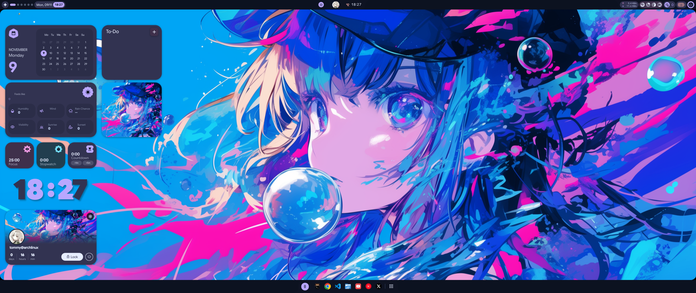
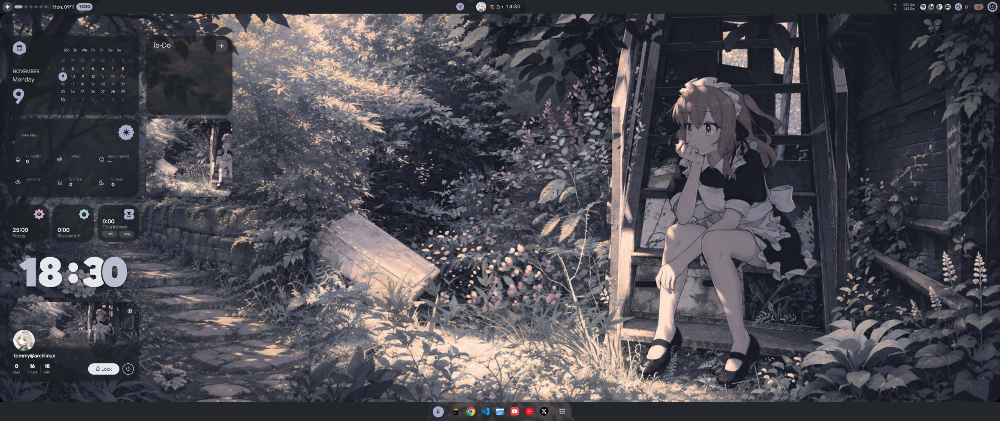
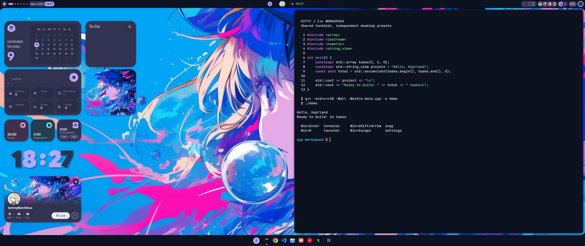
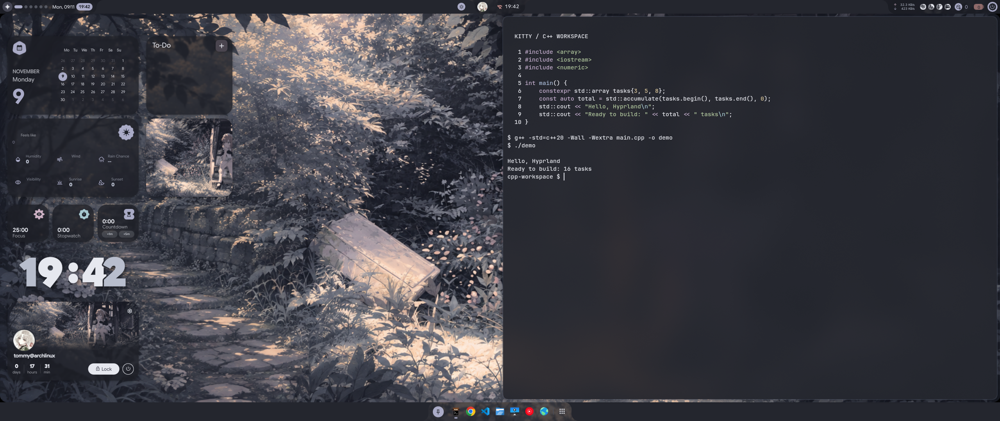

# tomjseery's Arch Linux dotfiles

Personal behaviour lives in `core/`. Desktop sessions and appearance have
separate modules and shell installers. GNU Stow links configuration into your
home folder; settings mixing behaviour and appearance are merged by key.

## Hyprland desktop gallery

An anime desktop with a top status bar, grouped widgets, a bottom app dock and a
shared Kitty coding terminal. Choose a look below; both use the same controls
and remember your last selected preset.

| [Blue Anime](themes/hyprland/blue/README.md) | [Charcoal Anime](themes/hyprland/charcoal/README.md) |
| --- | --- |
| [](themes/hyprland/blue/README.md) | [](themes/hyprland/charcoal/README.md) |
| Navy, violet and cyan; opaque panels and terminal. | Dark grey; frosted widgets and a translucent terminal. |
| [](themes/hyprland/blue/README.md) | [](themes/hyprland/charcoal/README.md) |

[Hyprland installation and controls](desktops/hyprland/README.md) ·
[Preset comparison and credits](themes/hyprland/README.md)

These are real 2560×1080 nested Hyprland captures. The setup targets Arch Linux;
it can be installed independently of the personal core and KDE modules.

## Layout

```text
core/
  mouse/                 MMB scrolling, app routing, KWin cursor effect
  agents/keep-awake/      agent activity and automatic idle-sleep prevention
  app-configs/           Chromium and Thunderbird behaviour
  configs/               shell, keyboard, shortcuts, apps and helper commands
  settings/              personal keys from mixed KDE and app configuration
  system-configs/        machine policy
  packages/              core AUR application list
desktops/hyprland/       shared Hyprland configuration, source pins and patches
desktops/kde/            KDE login/session setup
themes/hyprland/         Blue and Charcoal presets, guides and screenshots
themes/shared/icons/     shared KDE/Hyprland application icon choice
components/qswitch/      optional existing graphical Quickshell switcher
themes/current/          saved appearance, panel layout, assets and theme packages
install/                 separate shell entry points
scripts/                 settings merge helper
tests/                   disposable-home installation checks
```

Core owns your personal preferences, including mouse configuration. Some
integrations require a particular desktop: the current fallback scroll cursor
uses KWin; that cursor effect applies to Plasma, independently of the Hyprland
appearance setup.

`themes/current/` preserves your existing Catppuccin/Zero Two appearance.
The approved Hyprland desktop is saved under `desktops/hyprland/`, with Blue
and Charcoal visual presets under `themes/hyprland/`; see its
[installer and controls](desktops/hyprland/README.md). Persona was rejected and
remains outside Git. Large upstream downloads stay outside Git.
Wallpapers and external themes referenced by this profile remain in their
existing locations; this repository is not a complete artwork backup.

## Install one part

Run from this repository as your desktop user. Root stages use `pkexec` to
open the graphical administrator prompt.

| Script | Installs or reapplies |
| --- | --- |
| `./install/core.sh` | Personal configuration **and core mouse behaviour** |
| `./install/core.sh --configs-only` | Personal configuration without package/service changes |
| `./install/mouse.sh` | Only the core MMB integration |
| `./install/agents.sh` | Agent configuration and keep-awake user service; [details](core/agents/keep-awake/README.md) |
| `./install/system.sh` | Core official packages, services and Chrome system policy |
| `./install/icons.sh` | Shared Papirus-Dark icons for KDE and Hyprland; [details](themes/shared/icons/README.md) |
| `./install/hyprland-packages.sh` | Hyprland desktop dependencies via graphical approval |
| `./install/hyprland.sh` | Shared Hyprland setup and Blue/Charcoal presets |
| `./install/kde.sh` | KDE shortcuts, keyboard and personal KConfig settings |
| `./install/kde.sh --system` | Existing SDDM/Wayland login setup |
| `./install/theme.sh` | Saved appearance, then reassert core settings |
| `./install/aur.sh core` | Core AUR applications |
| `./install/aur.sh theme` | Current appearance's AUR dependencies |
| `./install/qswitch.sh` | Optional pinned Qswitch GUI; [component guide](components/qswitch/README.md) |
| `./install/login.sh` | Astronaut login theme, normal startup login by default; [options](themes/login/astronaut/README.md) |

Core, KDE user config and theme installers accept `--dry-run`. The AUR script
accepts it after `core` or `theme`. Stow checks conflicts before linking and
refuses unrelated existing files. Reconcile reported conflicts first; the scripts
do not adopt your files. The workstation Stow layout expects `~/.config`.

Core and appearance have separate fragments for KDE, KWin, Flatpak Konsole,
VS Code and Vesktop. Their live files are ordinary files: applications can
update them, and installation preserves keys the fragments do not own. Save
intentional changes to the appropriate fragment before reapplying an installer.
Existing JSON settings must be valid JSON; comments cause a safe refusal.
Kitty's core config includes a separate `theme.conf` for colours and background.
It then loads an optional `desktop-${XDG_CURRENT_DESKTOP}.conf`; the current
profile supplies `desktop-KDE.conf` for a solid dark Dracula background and bold font
in Plasma, leaving other desktops on the base theme.

Apply a changed Plasma panel layout outside a running Plasma session, from a
text console or another desktop session. The theme installer refuses to change
that layout while Plasma is running. Reopen apps or log in again to reload
settings. Mouse installation and theme installation are independent; Thunderbird
styling is applied only by the theme installer.

The saved panel uses Icons-only Task Manager with applications grouped by
program and manual sorting. Running windows occupy their pinned icon, where
the Plasma style supplies the running and active backgrounds. The browser pin
follows the default browser rather than naming a particular browser.

If a changed application launcher appears separately from its pin, rebuild
KDE's application database with `kbuildsycoca6 --noincremental` from the desktop
session's locale. Custom launchers sharing the same `StartupWMClass` can make
window matching ambiguous; changing grouping settings does not resolve that.

## Setting up a new machine

1. Install Git and clone the repository:

   ```sh
   pkexec pacman -S --needed git
   mkdir -p ~/projects
   git clone https://github.com/tomjseery/dotfiles.git ~/projects/dotfiles
   cd ~/projects/dotfiles
   ```

2. Install `yay` if needed:

   ```sh
   pkexec pacman -S --needed base-devel
   git clone https://aur.archlinux.org/yay-bin.git /tmp/yay-bin
   (cd /tmp/yay-bin && makepkg --clean --cleanbuild --noconfirm)
   pkexec pacman -U --needed --noconfirm /tmp/yay-bin/yay-bin-*.pkg.tar.zst
   ```

3. Install the selected parts:

   ```sh
   ./install/system.sh
   ./install/aur.sh core
   ./install/aur.sh theme
   ./install/core.sh --configs-only
   ./install/kde.sh --system
   ./install/theme.sh
   ./install/icons.sh
   ./install/mouse.sh
   ./install/agents.sh
   ```

   `core.sh` normally includes mouse setup; `--configs-only` above leaves it
   until the separate mouse step. Choose modules independently on an existing
   machine. The KDE system stage configures SDDM and removes the old Plasma X11
   session; Xwayland remains available for legacy applications.

4. Restore external theme/font/wallpaper assets referenced by your chosen
   appearance, then reboot. KWin loads the cursor effect on the next login.

## Configuration packages

`core/configs/` contains independently usable Stow packages: `shell`, `apps`,
`bin`, `kitty`, `vscode` and `kde`. Use the shell
installers to include merged settings as well as links. Core includes the
input and application behaviour; `themes/current/files/` contains the visual
Stow package. Flatpak Konsole settings use `~/.var/app/org.kde.konsole/config`.

Agent integrations live under `core/agents/`. The [keep-awake module](core/agents/keep-awake/README.md)
prevents automatic idle sleep during active turns while allowing manual Sleep.

## Verification

```sh
python3 -m unittest discover -s tests -v
```

Tests install into temporary home folders and do not touch packages or services.

The main `.bashrc` only contains a one-line loader for the managed shell
fragment, preserving the older machine-specific functions and aliases.

`restic-home` intentionally stores no password or repository URL. Configure
those through `RESTIC_REPOSITORY` and `RESTIC_PASSWORD_FILE` (or
`RESTIC_PASSWORD_COMMAND`) after choosing an external or remote destination.

`finish-arch-setup` performs the root-owned package and service stage. It is
kept separate so administrator authentication never needs to pass through an
automation session. It installs the Chrome enterprise policy below. SDDM is installed separately
with `install/kde.sh --system`.

`desktops/kde/system-configs/sddm/install` also patches `/etc/pam.d/sddm` so KWallet
auto-unlocks at login instead of prompting separately: Plasma 6 renamed the
wallet daemon to `ksecretd`, but `pam_kwallet5`'s default `auto_start` target
still points at the old `kwalletd5` binary, which no longer exists on this
system, so the patch adds `kwalletd=/usr/bin/ksecretd` explicitly. The wallet
password must also match the login password for this to actually unlock it
(set that once in KWallet's own settings; it isn't something a dotfile can
carry, per the credentials exclusion below).

`core/system-configs/chrome-policy` installs a machine-wide Chrome enterprise
policy (`QuicAllowed: false`) disabling QUIC/HTTP-3. QUIC runs over UDP, and
the Mullvad WireGuard tunnel this machine routes through drops/fragments QUIC
badly enough that Chrome hangs indefinitely retrying it (most visibly on
YouTube, whose video CDN opens a fresh QUIC connection per edge server) rather
than falling back to TCP promptly. Disabling it machine-wide costs a small
amount of latency on QUIC-capable sites in exchange for not hanging.

`core/app-configs/chromium/install-user` also writes `--password-store=basic` to
`~/.config/chrome-flags.conf`, so Chrome manages its own credential storage
instead of depending on the desktop keyring (KWallet) — a locked or
misconfigured wallet must never be able to hang the browser.

`core/packages/aur-packages.txt` lists core AUR packages (it is not a Stow
package itself). The mouse module declares its native-application helper in
`core/mouse/apps/chromium/aur-packages`.

## Mouse and middle-click autoscroll

Middle clicks remain native by default. Explicit fallback applications use the
pinned midscroll package only when a native compositor bridge confirms the actual
recipient. Unknown or stale targets remain native.

See [mouse setup, checks and recovery](core/mouse/README.md) for the owning
configuration, native application defaults and installation commands. The router
and the optional drawing effect are independent.

## Things deliberately kept out of this repo

Anything that's an account, session, or credential rather than a setting:
browser profiles (cookies/logins), `~/.config/gh` (GitHub token), Discord/
Vesktop session data, Mullvad/Proton account state, and any crypto wallet
data. Theme and keybinding *choices* are portable; logged-in sessions and
secrets are not.

## Repository conventions

[AGENTS.md](AGENTS.md) indexes the short, folder-specific rules for maintaining these modules.

## License

Original code is available under the [MIT License](LICENSE.md), except where a
file carries its own license notice. Third-party components, patches and artwork
retain their respective licenses; the MIT license does not replace those terms.
