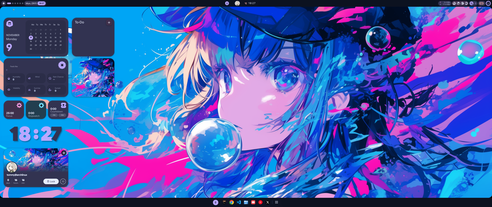
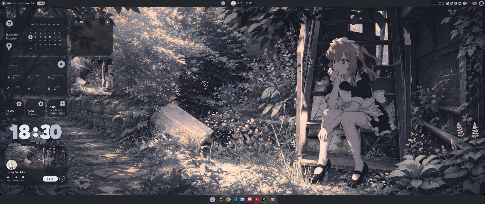

# Hyprland desktop

An End4-pC desktop based on the Asuka V2 layout, with a top status bar, grouped
desktop widgets, bottom app dock and shared Kitty coding terminal. Personal core configuration remains under
`core/`; Plasma configuration and appearance have their own installers.

Application icons inherit the [shared icon configuration](../../themes/shared/icons/README.md),
currently Papirus-Dark, independently of the visual preset.

## Choose a preset

| [Blue Anime](../../themes/hyprland/blue/README.md) | [Charcoal Anime](../../themes/hyprland/charcoal/README.md) |
| --- | --- |
| [](../../themes/hyprland/blue/README.md) | [](../../themes/hyprland/charcoal/README.md) |
| Solid navy terminal and vivid artwork. | Translucent charcoal terminal and frosted widgets. |

Each preset page includes a desktop preview, a real C++ terminal preview, palette
notes and customisation guidance. [Compare both presets](../../themes/hyprland/README.md).
Screenshots were captured in a real nested Hyprland session at 2560×1080, using
shell scale 0.8. The widget arrangement is tuned for that ultrawide size; other
screen sizes may need layout and scale adjustments.

## How it is organised

- `upstream.json`: exact end-4 Lua base and End4-pC shell revisions, artwork/font
  URLs and SHA-256 checksums. Large upstream trees and original artwork download
  to the local cache/runtime, outside Git.
- `base.patch`, `quickshell.patch`: the changes tested locally, including scoped
  paths, safe session controls, Kitty-only palette updates, frosted widgets and
  the two-tone clock. Upstream code stays upstream rather than being vendored.
- `shared/`: common layout seed, launchers, half-screen snapping, terminal and
  minimal pinned Python dependencies. The seed contains no provider credentials
  or browser profiles. Portable YouTube/X desktop entries avoid Chrome app IDs.
- [`../../themes/hyprland/`](../../themes/hyprland/): independent Blue and Charcoal
  appearance overlays, named palettes, generated ultrawide wallpapers and prompts.

## Install

From an Arch Linux desktop, clone the repository and run only the Hyprland
installers. Git must already be installed. A working graphical Polkit agent
provides the administrator prompt for package installation.

```sh
git clone https://github.com/tomjseery/dotfiles.git
cd dotfiles
./install/hyprland-packages.sh --dry-run
./install/hyprland-packages.sh
./install/hyprland.sh --dry-run
./install/hyprland.sh
```

The package stage installs Hyprland, Quickshell, Kitty, fonts and supporting tools.
The configuration stage fetches the pinned upstream sources and checksum-checked
artwork, then installs both presets. It does not run the personal core, KDE or
login-theme installers. Chrome, VS Code and YouTube Music are optional existing
applications; adjust the dock pins if you do not use them.

Log out when ready and choose **Hyprland** in your display manager's session
selector. The installer does not select the session or log you out. Blue is the
initial preset; choose Charcoal from Settings after login.

The saved shell/base were validated with **Hyprland 0.57.1** and **Quickshell
0.3.2** on Arch. Other distributions and multi-monitor layouts have not been
verified. This uses Hyprland's Lua configuration API. Native nested checks cover
rendering, switching, snapping and persistence; fresh-machine login, real sleep
and password unlock have not been verified by those checks.

If you already use another Hyprland configuration, back it up first. This
installer refuses an unrelated `~/.config/hypr/hyprland.lua`; `--adopt-trial` is
only for this repository's earlier local trial, not an overwrite switch.

For the existing approved local trial, use
`./install/hyprland.sh --adopt-trial` once. It backs up the configuration to
`~/.local/state/dotfiles/hyprland/backups/` before replacing managed files. It
refuses unrelated Hyprland startup files. It does not log out, restart a desktop,
change the display manager or remove packages.

The runtime retains `~/.local/share/dotfiles/end4-pc-trial/` as its directory name
so existing shortcuts, native presets and saved wallpaper paths keep working.
It is now reconstructed from this repository rather than an undocumented trial.
`~/.config/hypr/hyprland.lua` loads it; the launcher sets isolated config/state/
cache directories and a shell-only scale of 0.8 for the ultrawide screen.

Fresh installs start Blue. Reinstall preserves the entire live shell config,
including the selected theme, widgets and dock pins; it never copies user state
back into Git. Updates to shared defaults apply to fresh installs, while deliberate
changes to existing preferences belong in the native Settings UI. Runtime palette
files, task lists, notifications and credentials remain outside Git. Installation
replaces managed source files, so save source customisations as patches here.

The installer preserves global KDE, GTK, Neovim and other terminal appearance.
Only Kitty instances launched through `end4-pc-terminal` accept live palette/
opacity updates. No terminal agent is installed or authenticated by this theme.
Yan's Neovim starting point remains a separate local editor configuration.

## Switching and controls

Win+Escape → Presets → My presets → Blue Anime or Charcoal Anime. The fork's
native preset mechanism merges visual overlays, keeping shared controls and
apps. Startup uses whichever theme you selected last.

| Action | Shortcut |
| --- | --- |
| Terminal / app launcher / files | Win+Enter / Win+R / Win+E |
| Half-screen snap | Win+Shift+Left or Right |
| Move / resize window | Win+left-drag / Win+right-drag |
| Focus / cycle | Win+arrow / Alt+Tab |
| Workspace / send window | Win+1–9 / Win+Alt+1–9 |
| Floating / fullscreen / maximise | Win+Alt+Space / Win+F / Win+D |
| Close / lock / session menu | Win+Q / Win+L / Ctrl+Alt+Delete |
| Shortcut reference | Win+/ |

## Recovery and checks

The previous loader and `config/`, `presets/` directories are retained in the
printed backup. Restore those only outside a running Hyprland session, leaving
`state/` and `cache/` in place. The old rejected Persona trial is not adopted.

Run `python3 -m unittest discover -s tests -p test_hyprland.py -v`. The pinned
archive reconstruction test runs when the two source caches exist; the installer
populates them. It checks patch application and portable paths. Other checks cover
preset separation, preserving saved choice/pins on reinstall and refusing unrelated
startup files. Native nested compositor evidence and its limitations are recorded
in [the adoption plan](../../plans/hyprland-presets/PLAN.md).

## Capture previews without changing your theme

After installation, `python3 desktops/hyprland/preview.py` creates a temporary
HOME and a private D-Bus session, starts nested Hyprland through `start-hyprland`,
checks Charcoal across two full starts, switches natively to Blue and checks the
next full start. It saves real desktop and C++ terminal screenshots under
`/tmp/dotfiles-hyprland-gallery/`; use `--output /path/to/gallery` to choose a
folder. Capturing requires `bat`, `g++` and `grim` in addition to desktop tools.

The preview shares only immutable artwork, fonts and Python dependencies. It has
its own configuration, state, cache and terminal sockets, with credential lookups
disabled in that temporary profile. It never switches your real desktop's preset
or restores a stale copy of your preferences afterward.
