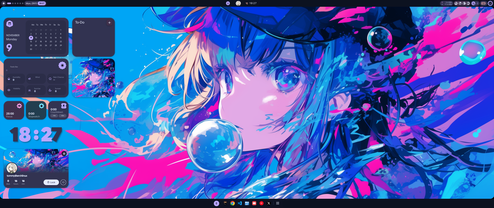
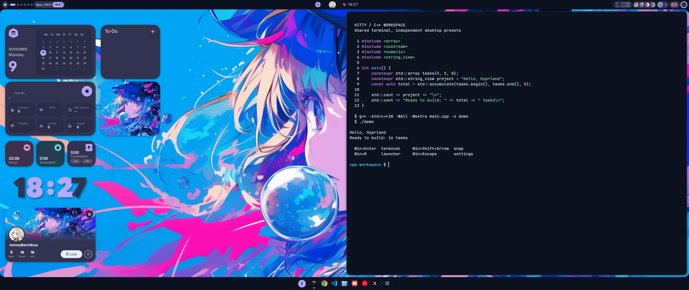

# Blue Anime

[Dotfiles](../../../README.md) · [Hyprland setup](../../../desktops/hyprland/README.md) · [All presets](../README.md) · [Charcoal](../charcoal/README.md)

Vivid blue anime artwork with navy surfaces and violet, cyan and pink accents.
Panels and Kitty stay opaque, keeping text clear against the colourful wallpaper.

## Terminal

The shared Kitty terminal uses a solid navy background and readable ANSI colours.
This real preview shows a C++ source file, compilation and output, snapped to the
right half of the desktop.

## Try it

Follow the [shared Hyprland installation guide](../../../desktops/hyprland/README.md).
Both presets install together; Blue is the initial choice on a fresh install.
Press **Win+Escape → Presets → My presets → Blue Anime** to apply it later.
Your last selected preset is remembered at the next startup.

| Setting | Blue |
| --- | --- |
| Base surface | `#0c1220` navy |
| Primary accent | `#b9a7ff` violet |
| Secondary accent | `#71d9f4` cyan |
| Third accent | `#f49be4` pink |
| Kitty background opacity | `1.0` |
| Widget glass | Off |

## Make it yours

`scheme.json` owns the named palette; `settings.json` owns visual settings such
as wallpaper selection, panel transparency and terminal opacity. Use the native
settings UI to experiment, then save the intended visual changes here if you
want to reproduce them. Live changes are not automatically exported into Git.

Installation creates `wallpaper.png` pointing to the original downloaded artwork.
`wallpaper-ultrawide-v1.png` is an optional generated wider composition, retained
with its prompt; it is not the default. Choose it through the wallpaper picker
if you prefer that framing, then update the preset's wallpaper paths to retain
that choice on fresh installs.

Shortcuts, apps, dock position and terminal behaviour are shared with Charcoal.
Keep those changes in [`desktops/hyprland/shared/`](../../../desktops/hyprland/shared/).
The preview uses 2560×1080; widget positions may need adjusting on other screens.

## Artwork and credits

Original artwork: [robokoboto on Alpha Coders](https://wall.alphacoders.com/big.php?i=1358147).
Its source lists personal use. Original downloads are checksum-checked and kept
outside Git; generated adaptation and screenshot inclusion do not change the
artist's rights. See [shared source credits](../README.md#sources) for the shell,
Asuka V2 layout and generated-image provenance.
