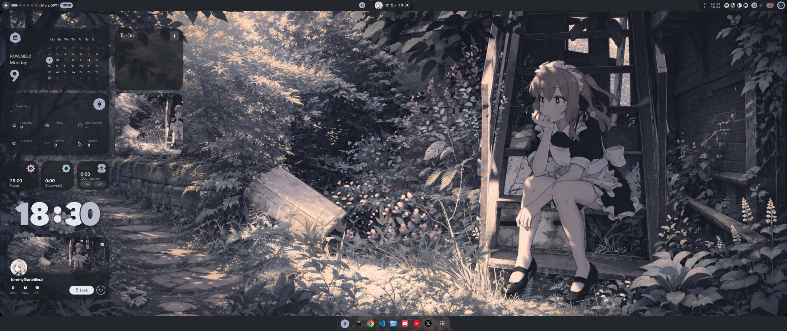
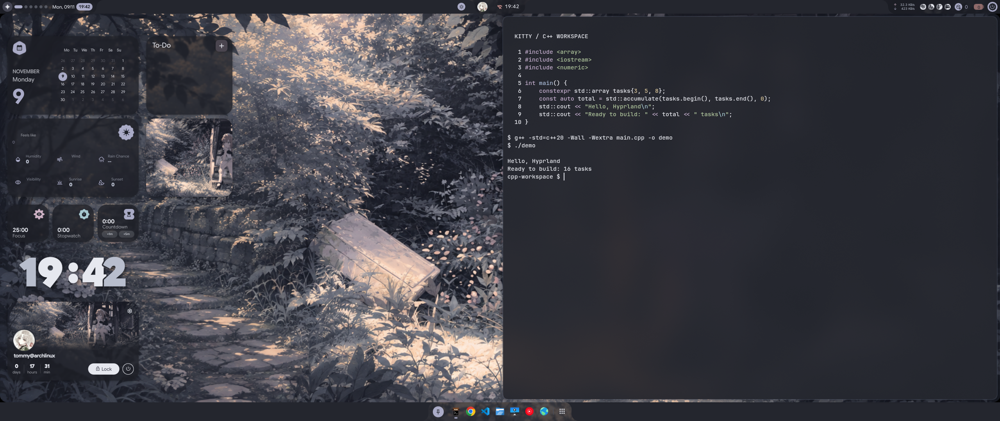

# Charcoal Anime

[Dotfiles](../../../README.md) · [Hyprland setup](../../../desktops/hyprland/README.md) · [All presets](../README.md) · [Blue](../blue/README.md)

A quiet charcoal palette, muted lavender accents and an illustrated garden.
Frosted mini dashboards let the wallpaper show through, while the clock uses
two pale tones for contrast.

## Terminal

Kitty uses **0.92 background opacity**, with stronger compositor blur behind it (size 8, three passes). Text stays
fully opaque. The real preview shows a C++ source file, compilation and output,
snapped to the right half of the desktop.

## Try it

Follow the [shared Hyprland installation guide](../../../desktops/hyprland/README.md).
Then press **Win+Escape → Presets → My presets → Charcoal Anime**.
Both presets share the same desktop installation. Switching keeps your app pins,
shortcuts and running terminals, and your last choice is remembered at startup.

| Setting | Charcoal |
| --- | --- |
| Base surface | `#24262e` charcoal |
| Clock light tone | `#e6e8ef` |
| Clock muted tone | `#c5c9d8` |
| Kitty background opacity | `0.92` |
| Widget glass | On, with a charcoal tint |

## Make it yours

`scheme.json` owns the named palette; `settings.json` owns opacity, glass options,
clock contrast and wallpaper selection. Experiment in the native settings UI,
then save intended visual changes here to reproduce them. Live settings are not
automatically exported into Git.

`wallpaper.png` selects `wallpaper-ultrawide-v1.png`: a generated adaptation that
extends the garden sideways and shows more of the seated character. Its full
prompt is saved alongside it. The original `kita.png` is downloaded separately
under the runtime's `assets/reference/` directory.

Shortcuts, apps, dock position and terminal behaviour are shared with Blue.
Keep those changes in [`desktops/hyprland/shared/`](../../../desktops/hyprland/shared/).
The preview uses 2560×1080; widget positions may need adjusting on other screens.

## Artwork and credits

Original wallpaper: [kita.png in ViegPhunt's Wallpaper Collection](https://github.com/ViegPhunt/Wallpaper-Collection/blob/main/Wallpapers/kita.png).
Visual inspiration, including terminal opacity, comes from
[ViegPhunt's Dotfiles](https://github.com/ViegPhunt/Dotfiles). This preset adapts
those visual ideas to the shared End4-pC desktop. Source artwork rights still
apply; see [shared source credits](../README.md#sources) for shell/layout credits
and generated-image provenance.
